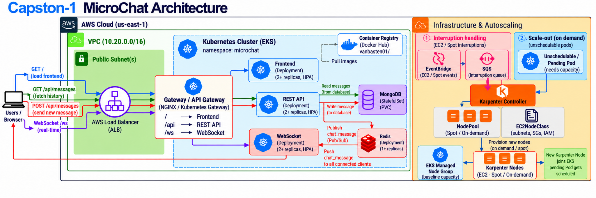
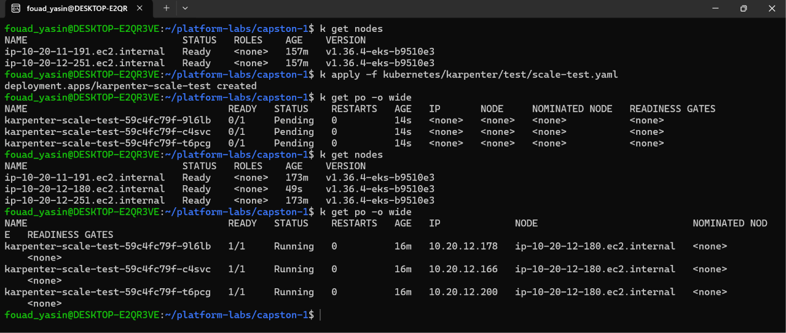
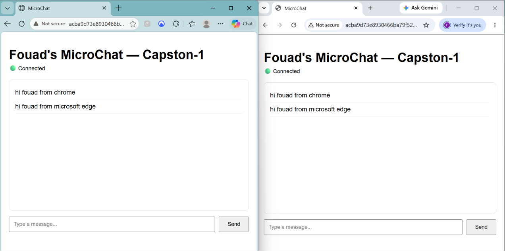
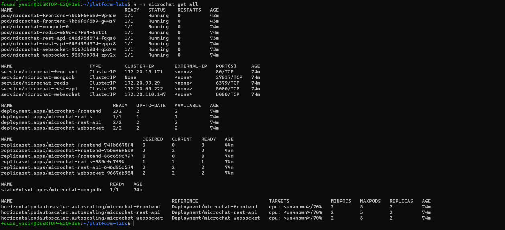
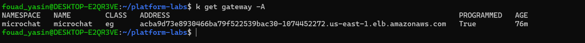

# Capston-1 — MicroChat on AWS EKS

A containerized real-time chat application deployed on **Amazon EKS** in `us-east-1`. The project demonstrates infrastructure as code (Terraform), Kubernetes workload deployment, event-driven node provisioning with Karpenter, and a cost-conscious cluster design using baseline capacity plus Spot capacity.

## 1. Infrastructure architecture — Terraform and AWS

Terraform defines the AWS infrastructure, including the VPC (`10.20.0.0/16`), subnets, security groups, EKS cluster, baseline managed node group, and the IAM/networking components required by Karpenter. The infrastructure is separated into Terraform modules and a `dev` environment so it can be reviewed and managed reproducibly.



### Karpenter: scale-out and Spot interruption handling

Karpenter complements the EKS managed node group rather than replacing it:

- **Baseline capacity:** the EKS managed node group provides steady capacity for core and existing workloads.
- **Scale-out:** when Pods remain unschedulable because available nodes cannot satisfy their scheduling requirements, the Karpenter controller evaluates the pending Pods against the `NodePool` and `EC2NodeClass`, then provisions a suitable Spot or On-Demand EC2 node. Once the node joins EKS, the pending Pods can be scheduled.
- **Spot interruption handling:** AWS interruption events are matched by EventBridge and delivered to the SQS interruption queue. The Karpenter controller consumes the queue, coordinates node disruption/termination, and can provision replacement capacity when needed so workloads have an opportunity to move.
- **Evidence:** the scale test started with three Pending Pods because the baseline nodes did not match their Karpenter workload selector. Karpenter launched a Spot node and all three Pods reached `Running` on it.



### Cost-conscious design

The design aims to control compute costs by keeping a managed node group for baseline capacity and using Karpenter to add capacity when scheduling demand requires it. The `NodePool` permits Spot instances and configures consolidation so eligible underutilized capacity can be removed or optimized. Spot capacity can be interrupted by AWS, so interruption handling is configured through EventBridge and SQS. Actual savings depend on workload demand, instance availability, storage, networking, and regional prices; this design does not guarantee a specific cost reduction.

## 2. Application architecture — MicroChat on Kubernetes

The `microchat` namespace contains the frontend, REST API, WebSocket service, Redis, and MongoDB. The frontend, REST API, and WebSocket workloads use multiple replicas and have HPA resources configured. MongoDB runs as a StatefulSet with persistent storage; Redis supports Pub/Sub for real-time message delivery.

### End-to-end request flows

- **Blue — `GET /`:** Browser → AWS Load Balancer → Gateway/API Gateway → Frontend.
- **Green — `GET /api/messages`:** Browser → AWS Load Balancer → Gateway/API Gateway → REST API → MongoDB (read) → Browser. This flow retrieves message history.
- **Red — `POST /api/messages`:** Browser → AWS Load Balancer → Gateway/API Gateway → REST API. The API writes the message to MongoDB and publishes a `chat_message` event to Redis. WebSocket subscribers receive the event and broadcast it to connected browsers.
- **Purple — `WebSocket /ws`:** Browser → AWS Load Balancer → Gateway/API Gateway → WebSocket service. This establishes the persistent client connection used for real-time delivery.

## 3. Deployment evidence

### Application running

Two browser sessions show connected clients with messages visible in both windows, demonstrating real-time message delivery.



### Kubernetes workloads

Pods, Services, Deployments, the MongoDB StatefulSet, and HPA resources are shown in the captured cluster output.



### Public Gateway endpoint

The Gateway resource is `Programmed=True` and exposes an AWS load-balancer address.



## 4. Provision infrastructure and deploy workloads

### Step 1 — Provision the AWS infrastructure

Run from the repository root:

```bash
cd terraform/environments/dev
terraform init
terraform validate
terraform plan
# Review the plan before applying:
terraform apply
```

After provisioning, configure `kubectl` to use the new EKS cluster and verify the nodes:

```bash
kubectl get nodes
```

### Step 2 — Deploy the application with Helm

The application source is in `app/`, and the Helm chart is in `helm/microchat/`. Run these commands from the **Capston-1 repository root** after the EKS cluster is available and your `kubectl` context is configured.

Create a local secrets file from the committed example:

```bash
cp values-secrets.yml.example values-secrets.yml
```

Edit `values-secrets.yml` and replace the placeholders with strong, unique Redis and MongoDB credentials. Keep this file local; **never commit `values-secrets.yml`**. Commit only `values-secrets.yml.example`, which must contain placeholders.

Validate and install the Helm chart:

```bash
helm lint helm/microchat/

helm install microchat helm/microchat/ \
  --values values-secrets.yml \
  --namespace microchat \
  --create-namespace
```

If the `microchat` Helm release already exists, use `helm upgrade` instead of `helm install`.

### Step 3 — Verify the workloads and Karpenter

```bash
kubectl -n microchat get pods,services
kubectl get gateway -A
kubectl get nodeclaims
```

Karpenter manifests are under `kubernetes/karpenter/`. Apply the NodeClass and NodePool before running the temporary scale test:

```bash
kubectl apply -f kubernetes/karpenter/ec2nodeclass.yaml
kubectl apply -f kubernetes/karpenter/nodepool.yaml
kubectl apply -f kubernetes/karpenter/test/scale-test.yaml
kubectl get pods -o wide -w
```

Remove the test workload when finished:

```bash
kubectl delete -f kubernetes/karpenter/test/scale-test.yaml
```

## 5. Cleanup and cost awareness

When the environment is no longer needed, review the Terraform workspace, state, and planned changes before destroying resources:

```bash
cd terraform/environments/dev
terraform plan -destroy
# Run only when you are certain the environment can be removed:
terraform destroy
```

EKS, EC2 nodes, load balancers, NAT gateways, persistent volumes, and related AWS resources may continue to incur charges while provisioned. Keep credentials, secret values, and Terraform state out of Git. Screenshots are evidence captured during testing; live resource status may change after capture.

