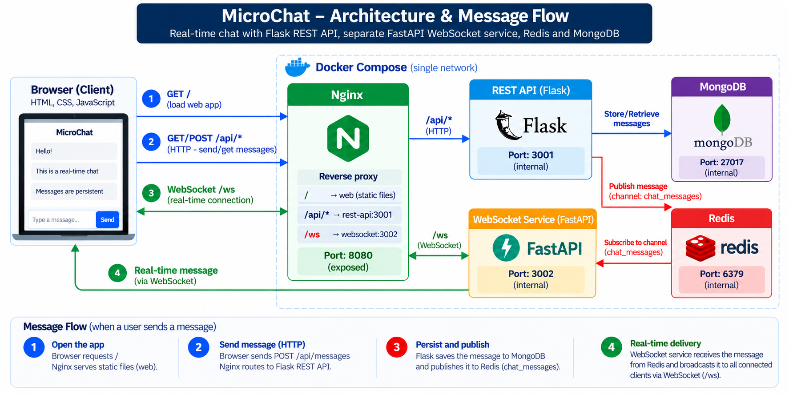
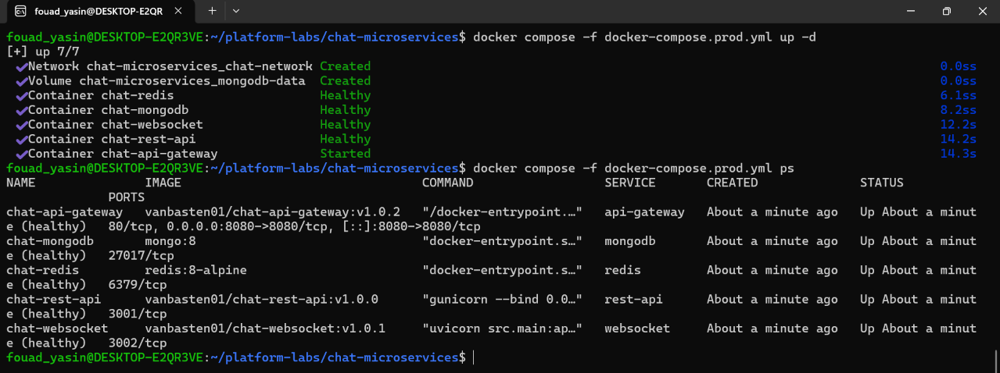

# MicroChat — Real-Time Microservices Platform

> A production-minded real-time chat platform built with **Flask, FastAPI, Redis Pub/Sub, MongoDB, Nginx, and Docker Compose**.

[](https://github.com/vanbasten01/platform-labs/actions/workflows/chat-microservices-ci.yml)  
[View CI workflow](https://github.com/vanbasten01/platform-labs/blob/feature/chat-microservices/.github/workflows/chat-microservices-ci.yml)

MicroChat demonstrates how to separate **HTTP APIs, real-time communication, persistence, messaging, and edge routing** into independently deployable services while keeping the runtime simple and reproducible.

## Architecture



### Request & message flow

```text
Browser
   │
   ▼
Nginx :8080
   ├── /          ───────────────► Static Web UI
   ├── /api/*     ───────────────► Flask REST API :3001
   │                                  ├──► MongoDB
   │                                  └──► Redis Pub/Sub
   │                                         │
   └── /ws       ◄────────────────────────────┘
                     FastAPI WebSocket :3002
                              │
                              ▼
                     Connected clients
```

### Why this design?

- **Nginx** is the single public entry point and reverse proxy.
- **Flask** owns HTTP message operations and persistence.
- **MongoDB** is the persistent source of truth for messages.
- **Redis Pub/Sub** distributes new messages between services.
- **FastAPI** owns long-lived WebSocket connections and real-time delivery.
- **Docker Compose** provides a reproducible multi-service runtime.

## Live Verification

Two independent browser clients connected through the gateway and exchanged messages in real time.


The test verifies the complete path:

```text
Browser → Nginx → Flask → MongoDB + Redis → FastAPI → WebSocket clients
```

## Production-Style Deployment

All services run as containers on a shared Docker network, with only the gateway exposed to the host.



```text
Public
  │
  ▼
Nginx :8080
  │
  ├── Flask REST API :3001
  ├── FastAPI WebSocket :3002
  ├── MongoDB :27017
  └── Redis :6379
```

Internal application services are not published directly to the host.

## Services

| Service | Technology | Responsibility |
|---|---|---|
| `api-gateway` | Nginx | Static UI + reverse proxy |
| `rest-api` | Flask + Gunicorn | REST API, persistence, Redis publishing |
| `websocket` | FastAPI + Uvicorn | WebSocket connections + Redis subscription |
| `mongodb` | MongoDB | Persistent message storage |
| `redis` | Redis Pub/Sub | Real-time message distribution |
| `web` | HTML/CSS/JavaScript | Browser client |

## API Surface

| Endpoint | Method | Purpose |
|---|---|---|
| `/` | `GET` | Serve the web application |
| `/api/messages` | `GET` | Retrieve persisted messages |
| `/api/messages` | `POST` | Persist and publish a message |
| `/ws` | WebSocket | Receive real-time broadcasts |

## Build & Run

### 1. Configure environment

Create the environment file from the provided example:

```bash
cp .env.example .env
```

Review `.env` before starting the stack. **Never commit secrets.**

### 2. Build the images

Development/local build:

```bash
docker compose -f docker-compose.yml build
```

Production build:

```bash
docker compose -f docker-compose.prod.yml build
```

### 3. Start the production stack

Pull the versioned images and start the services:

```bash
docker compose -f docker-compose.prod.yml pull
docker compose -f docker-compose.prod.yml up -d
```

Verify the deployment:

```bash
docker compose -f docker-compose.prod.yml ps
```

Open:

```text
http://localhost:8080
```

For functional verification, open the application in two browsers or two tabs and send messages from both clients.

### 4. Stop the stack

```bash
docker compose -f docker-compose.prod.yml down
```

MongoDB data is persisted through the configured Docker volume.

## Docker Image Footprint

Each application service is packaged as an independent image so it can be versioned, cached, scanned, and delivered separately.

| Image | Purpose | Size |
|---|---|---:|
| `chat-rest-api` | Flask REST API | Check current build |
| `chat-websocket` | FastAPI WebSocket service | Check current build |
| `chat-api-gateway` | Nginx gateway + web UI | Check current build |

Check the actual local image sizes with:

```bash
docker images \
  vanbasten01/chat-rest-api \
  vanbasten01/chat-websocket \
  vanbasten01/chat-api-gateway
```

## Security

Security is addressed at both the **individual service level** and in the **CI/CD pipeline**.

- Each microservice maintains its own security documentation, reports, and assessment artifacts.
- **Trivy** scans container images for **HIGH** and **CRITICAL** vulnerabilities before publication.
- The CI pipeline can fail when vulnerable HIGH/CRITICAL findings are detected.
- **Nginx** is the single public entry point.
- Backend services remain on the internal Docker network and are not directly exposed to the host.
- Environment-specific configuration is supplied through `.env` / environment variables rather than committed credentials.
- Security evidence stays with the service it applies to, making findings easier to trace and maintain.

Example structure:

```text
api-gateway/
├── Dockerfile
├── ...
└── security/
    └── reports and assessment artifacts

rest-api/
├── Dockerfile
├── ...
└── security/
    └── reports and assessment artifacts

websocket/
├── Dockerfile
├── ...
└── security/
    └── reports and assessment artifacts
```

## CI/CD

The GitHub Actions pipeline is designed around **service-level delivery** rather than rebuilding the entire stack for every change.

- Detects which microservice paths changed.
- Builds only affected Docker images.
- Supports manual service selection with `workflow_dispatch`.
- Uses **Docker BuildKit / GitHub Actions cache**.
- Scans images with **Trivy** for HIGH and CRITICAL vulnerabilities.
- Publishes versioned images to Docker Hub.
- Calculates the next patch version independently for each image.
- Uses semantic image tags such as `v1.0.1`, `v1.0.2`, etc.
- Avoids publishing a mutable `latest` tag.
- Pushes the exact image that passed the security scan.

## Repository Structure

```text
chat-microservices/
├── api-gateway/
│   ├── Dockerfile
│   ├── ...
│   └── security/
├── rest-api/
│   ├── Dockerfile
│   ├── ...
│   └── security/
├── websocket/
│   ├── Dockerfile
│   ├── ...
│   └── security/
├── web/
│   ├── index.html
│   └── ...
├── docs/
│   └── images/
├── docker-compose.yml
├── docker-compose.prod.yml
├── .env.example
├── .dockerignore
└── README.md
```

## Engineering Highlights

**Separation of concerns**  
REST, WebSocket handling, persistence, messaging, and edge routing have clear service boundaries.

**Event-driven real-time delivery**  
The REST service persists the message first, then publishes an event to Redis. The WebSocket service subscribes and broadcasts it to connected clients.

**Single public entry point**  
Nginx exposes the application while backend services remain internal to the Compose network.

**Containerized delivery**  
Each application service is packaged as a Docker image and can be versioned and deployed independently.

**Graceful WebSocket shutdown**  
The WebSocket service cleans up Redis subscriptions, connections, and connected clients during application shutdown.

**Security-aware CI**  
Container images are scanned before being pushed, with vulnerable HIGH/CRITICAL findings capable of failing the pipeline.

**Reproducible environments**  
Docker Compose provides consistent development and production-style service orchestration.

## Technology Stack

`Python` · `Flask` · `FastAPI` · `Gunicorn` · `Uvicorn` · `Redis` · `MongoDB` · `Nginx` · `Docker` · `Docker Compose` · `GitHub Actions` · `BuildKit` · `Trivy`

---

### Project Objective

MicroChat is intentionally small in product scope but demonstrates core engineering patterns behind larger distributed systems:

**API gateway → stateless services → event distribution → persistent storage → real-time clients → automated container delivery.**
