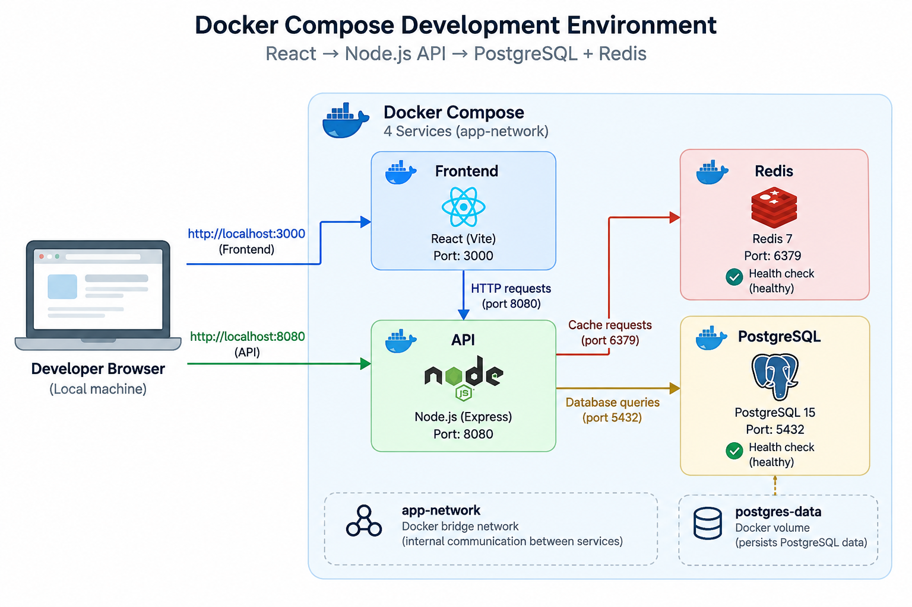
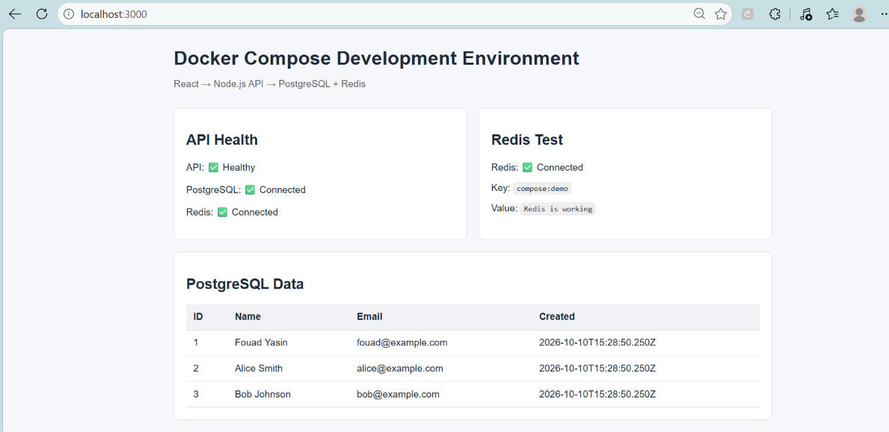
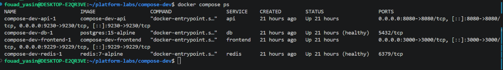

# Docker Compose Development Environment

A local development environment built with Docker Compose for a React frontend, Node.js API, PostgreSQL database, and Redis cache.

## Architecture



The environment consists of four Docker Compose services:

- **Frontend** — React + Vite, exposed on port `3000`
- **API** — Node.js + Express, exposed on port `8080`
- **PostgreSQL** — PostgreSQL 15, internal port `5432`
- **Redis** — Redis 7, internal port `6379`

The services communicate through the custom `app-network` Docker bridge network. PostgreSQL data is persisted using the `postgres-data` named volume.

The API depends on PostgreSQL and Redis health checks before starting.

## Services

| Service | Technology | Port | Purpose |
|---|---|---:|---|
| Frontend | React + Vite | 3000 | Web interface |
| API | Node.js + Express | 8080 | REST API |
| Database | PostgreSQL 15 | 5432 | Application data |
| Cache | Redis 7 | 6379 | Cache / key-value storage |

## Application Screenshot

The running dashboard demonstrates the API, PostgreSQL, and Redis connections working successfully, together with sample PostgreSQL data.



## Docker Compose Health Checks

The environment runs four containers:

- API
- PostgreSQL
- Frontend
- Redis

PostgreSQL and Redis report `healthy` status through Docker health checks.



## Environment Configuration

Database configuration is provided through environment variables.

Create the local environment file from the example:

```bash
cp .env.example .env
```

The `.env` file is ignored by Git and should not be committed.

## Start the Environment

```bash
docker compose up -d
```

Check the containers:

```bash
docker compose ps
```

## Verification

API health:

```bash
curl http://localhost:8080/api/health
```

PostgreSQL data:

```bash
curl http://localhost:8080/api/users
```

Redis:

```bash
curl http://localhost:8080/api/redis
```

Run the API tests:

```bash
docker compose exec api npm test
```

## Development

The development override bind-mounts the frontend and API source code into the containers, allowing source changes to be available without rebuilding the images.

Start with:

```bash
docker compose up -d
```

Rebuild when Dockerfile or dependency changes are required:

```bash
docker compose up -d --build
```

## Database Persistence

PostgreSQL uses the named volume:

```text
postgres-data
```

To reset the database completely:

```bash
docker compose down -v
docker compose up -d
```

> Warning: `docker compose down -v` deletes the PostgreSQL volume and all stored database data.

## Useful Commands

View all logs:

```bash
docker compose logs -f
```

View API logs:

```bash
docker compose logs -f api
```

View service status:

```bash
docker compose ps
```

Stop the environment:

```bash
docker compose down
```

