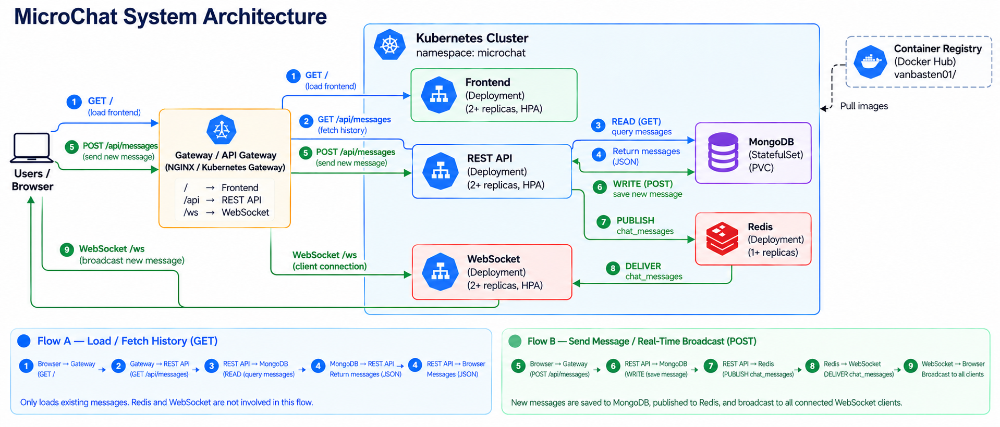
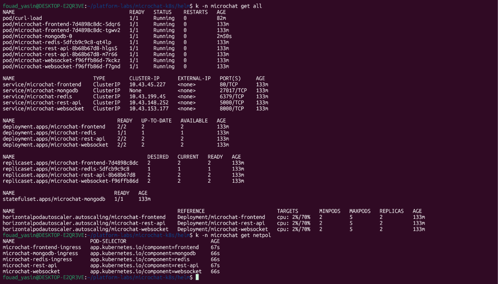
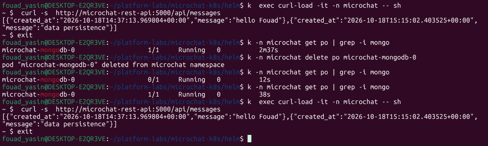
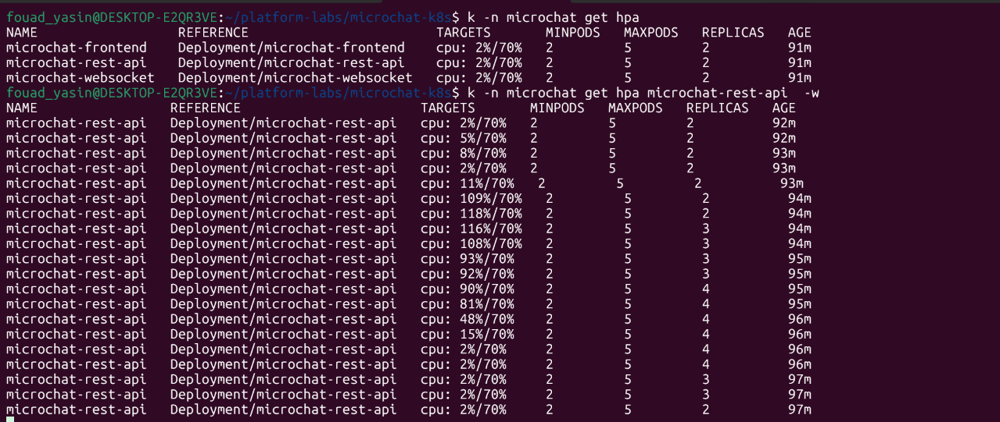
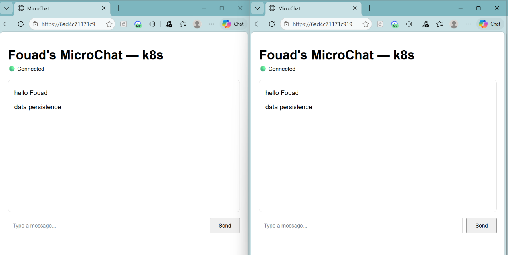

# MicroChat — Resilient Kubernetes Application

A containerized real-time chat application deployed on Kubernetes using Helm, with horizontal autoscaling, persistent MongoDB storage, internal services, and event-driven messaging through Redis Pub/Sub and WebSockets.

## System architecture



MicroChat runs in the `microchat` namespace. The Gateway/API Gateway routes requests to the frontend, REST API, or WebSocket service.

| Component | Kubernetes resource | Responsibility |
|---|---|---|
| Gateway / API Gateway | Gateway API infrastructure | Routes `/` to the frontend, `/api` to the REST API, and `/ws` to WebSocket |
| Frontend | Deployment + ClusterIP Service | Serves the web interface |
| REST API | Deployment + ClusterIP Service | Handles HTTP requests and message persistence |
| WebSocket | Deployment + ClusterIP Service | Broadcasts real-time messages to connected clients |
| MongoDB | StatefulSet + PVC | Persists chat messages |
| Redis | Deployment + ClusterIP Service | Distributes events through Pub/Sub |
| HPA | HorizontalPodAutoscaler | Scales application replicas based on CPU utilization |

The frontend, REST API, and WebSocket components have a minimum of two replicas and are configured with HPAs. MongoDB uses a StatefulSet with persistent storage.

### Technology stack

- Kubernetes and Helm
- Gateway API / API Gateway routing
- NGINX frontend
- REST API (Flask)
- WebSocket communication (FastAPI)
- MongoDB  with persistent storage
- Redis Pub/Sub
- Docker Hub images under `vanbasten01/`
- Metrics Server and Horizontal Pod Autoscaler

## Validation and test evidence

### Kubernetes resources



The captured cluster status shows the frontend, REST API, and WebSocket Deployments at `2/2` ready, Redis at `1/1`, MongoDB StatefulSet at `1/1`, and HPAs configured for 2–5 replicas. NetworkPolicies were present in the deployment; they were temporarily removed only to troubleshoot connectivity during testing.

### MongoDB persistence



After deleting and recreating the MongoDB pod, the API returned the same two messages, including `data persistence`. This verifies persistence across pod recreation, not recovery from node or volume failure.

### HPA scale-out and scale-down



During the load test, REST API CPU utilization exceeded the 70% target and the HPA scaled replicas from 2 to 4. After load decreased, the replica count returned to 2.

### Connected browser clients



Both browser clients show a `Connected` status and the same message history. This demonstrates that both clients loaded the existing messages and had active connections.

## Application request flows

- **GET `/api/messages`:** Browser → Gateway → REST API → MongoDB read → JSON response. Redis and WebSocket are not involved in this history-fetch flow.
- **POST `/api/messages`:** Browser → Gateway → REST API → MongoDB write → Redis Pub/Sub (`chat_messages`) → WebSocket → connected browsers.

MongoDB stores messages durably; Redis distributes events to the WebSocket layer for real-time delivery.

## Repository structure

The repository is organized around application source code, a Helm chart, architecture/test evidence, and a test directory.

```text
microchat-k8s/
├── app/
│   ├── frontend/
│   │   ├── Dockerfile
│   │   ├── nginx.conf
│   │   └── web/
│   │       └── index.html
│   ├── rest-api/
│   │   ├── Dockerfile
│   │   ├── requirements.txt
│   │   └── src/
│   │       └── app.py
│   ├── web/
│   │   └── index.html
│   └── websocket/
│       ├── Dockerfile
│       ├── requirements.txt
│       └── src/
│           └── main.py
├── docs/
│   └── images/
│       ├── micro-system-architecture.png
│       ├── all-microchat-ressources.png
│       ├── data-persistence-prove.png
│       ├── micro-chat-hpa.png
│       └── microchat-two-browser-clients.png
├── gatewayclass.yaml
├── helm/
│   └── microchat/
│       ├── Chart.yaml
│       ├── gatewayclass.yaml
│       ├── templates/
│       │   ├── frontend-configmap.yaml
│       │   ├── frontend-deployment.yaml
│       │   ├── frontend-hpa.yaml
│       │   ├── frontend-service.yaml
│       │   ├── gateway.yaml
│       │   ├── httproute.yaml
│       │   ├── mongodb-secret.yaml
│       │   ├── mongodb-service.yaml
│       │   ├── mongodb-statefulset.yaml
│       │   ├── networkpolicy.yaml
│       │   ├── pdb.yaml
│       │   ├── redis-deployment.yaml
│       │   ├── redis-secret.yaml
│       │   ├── redis-service.yaml
│       │   ├── rest-api-configmap.yaml
│       │   ├── rest-api-deployment.yaml
│       │   ├── rest-api-hpa.yaml
│       │   ├── rest-api-service.yaml
│       │   ├── storageclass.yaml
│       │   ├── websocket-configmap.yaml
│       │   ├── websocket-deployment.yaml
│       │   ├── websocket-hpa.yaml
│       │   └── websocket-service.yaml
│       ├── values-dev.yaml
│       ├── values-prod.yaml
│       ├── values-secrets.yaml
│       ├── values-staging.yaml
│       └── values.yaml
└── tests/
```

The tree above reflects the structure shown for the project; generated Python `__pycache__` directories are intentionally omitted.

## Prerequisites

- A Kubernetes cluster with sufficient CPU and memory.
- `kubectl` configured for the target cluster.
- Helm 3.
- Metrics Server installed and reporting resource metrics.
- A compatible Gateway API implementation and the required Gateway/HTTPRoute resources.
- Access to the required container images in Docker Hub.

## Deploy with Helm

Install the chart in the `microchat` namespace using `helm/microchat`. Environment-specific values are provided in `values-dev.yaml`, `values-staging.yaml`, and `values-prod.yaml`. Keep credentials in Secrets and do not commit real secret values.

The cluster requires Kubernetes, Helm 3, Metrics Server, and a compatible Gateway API implementation. The Gateway routes `/` to the frontend, `/api` to the REST API, and `/ws` to the WebSocket service.

## Resilience and autoscaling

- **HPA:** Frontend, REST API, and WebSocket target 70% CPU utilization and scale between 2 and 5 replicas.
- **Rolling updates:** Deployment strategy is intended to use `maxSurge: 1` and `maxUnavailable: 0` where configured, allowing a replacement pod to become available before an old one is removed.
- **Self-healing:** Deployments and the MongoDB StatefulSet recreate deleted pods.
- **Persistence:** MongoDB uses a StatefulSet and PersistentVolumeClaim mounted at `/data/db`.
- **PodDisruptionBudget:** The Helm chart includes `pdb.yaml` to help maintain minimum availability during voluntary disruptions.
- **Resource management:** Application deployments should define CPU/memory requests and limits and readiness/liveness probes.

## Security

The Helm chart includes NetworkPolicies, ConfigMaps, Secrets, and a PodDisruptionBudget. NetworkPolicies were temporarily removed only during connectivity troubleshooting and are otherwise part of the deployment.

Pod security contexts should enforce non-root execution where supported, disable privilege escalation, and drop unnecessary Linux capabilities. Keep application services internal with ClusterIP Services, expose traffic through the Gateway, and use Secrets for credentials. Validate the rendered chart to confirm that each container has appropriate probes and resource requests/limits and that NetworkPolicy rules permit only required traffic.

## Troubleshooting

For HPA issues, check Metrics Server and CPU requests. For connectivity problems, inspect Gateway/HTTPRoute configuration, Service endpoints, application logs, and NetworkPolicy rules. If MongoDB fails to restart, inspect pod logs, PVC binding, and volume permissions; do not delete the PVC while troubleshooting persistent data.

## Conclusion

MicroChat demonstrates a Kubernetes application composed of independently deployed frontend, REST API, and WebSocket services, with MongoDB persistence and Redis-backed real-time messaging.

The included evidence documents the observed resource state, message persistence across MongoDB pod recreation, and REST API HPA scale-out and scale-down. Rolling-update availability and the enforcement of security policies should be documented with their own test results before claiming that every resilience and security requirement has been verified.

