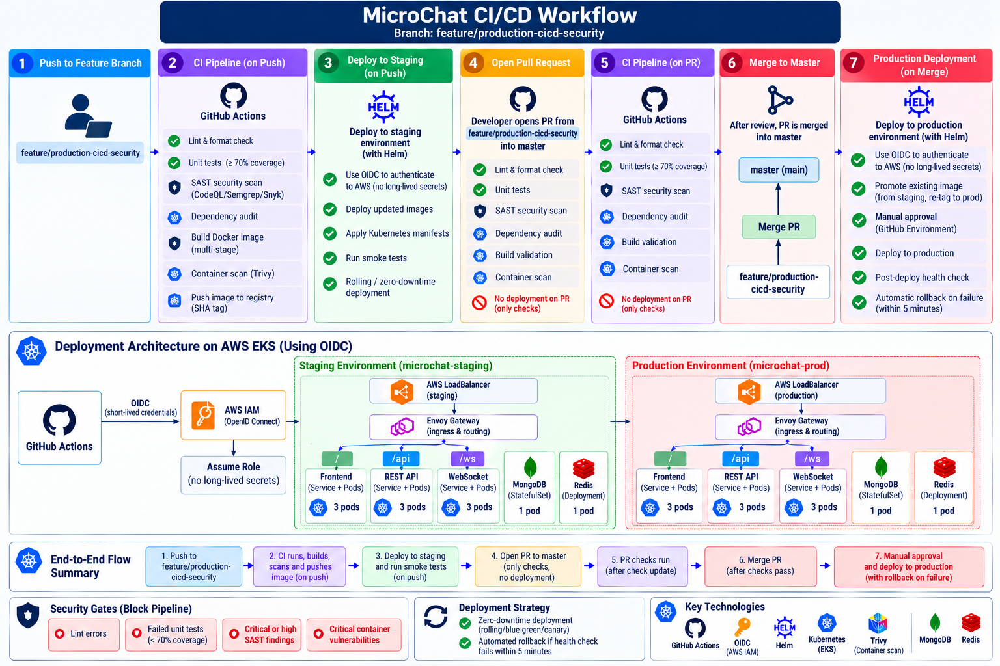
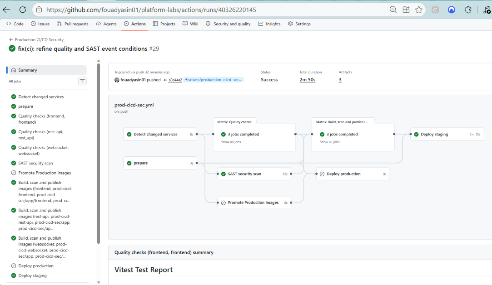
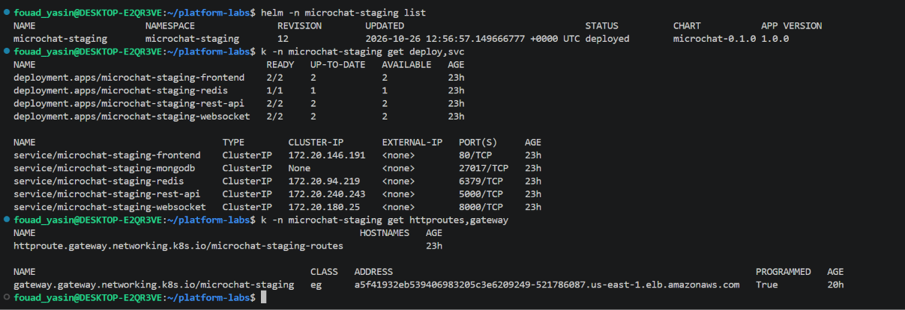
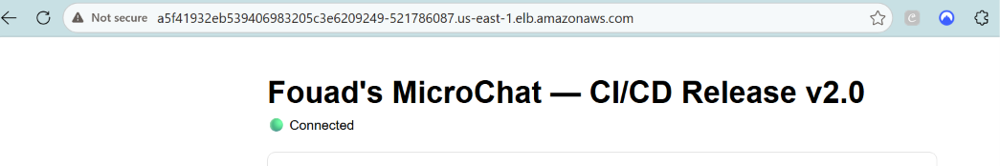
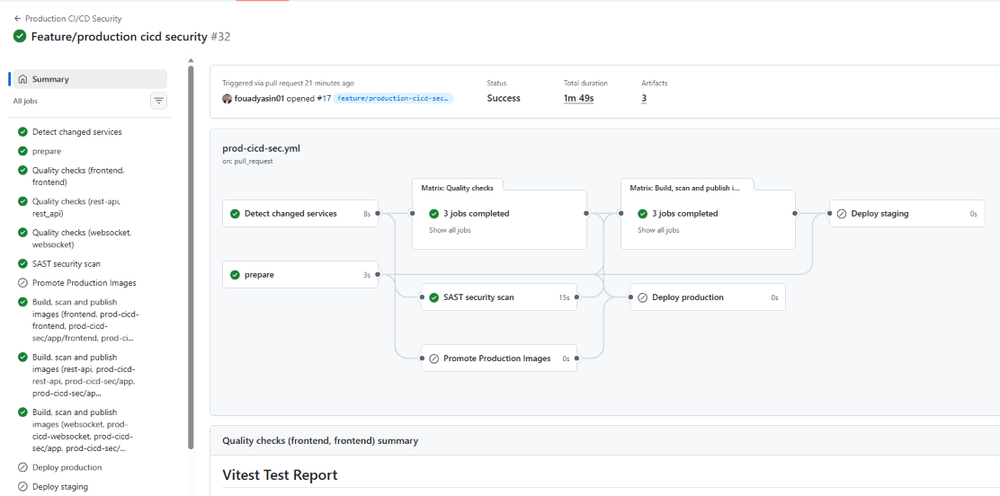
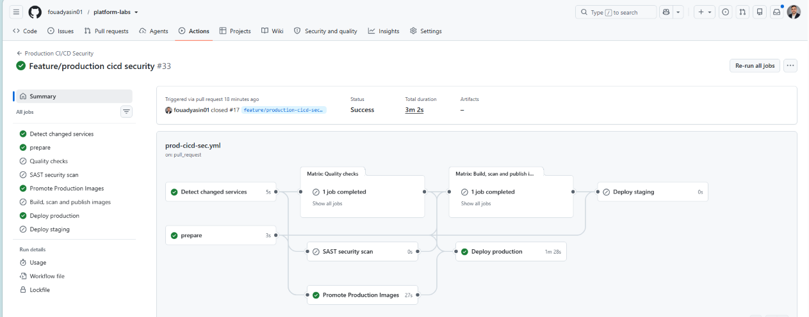
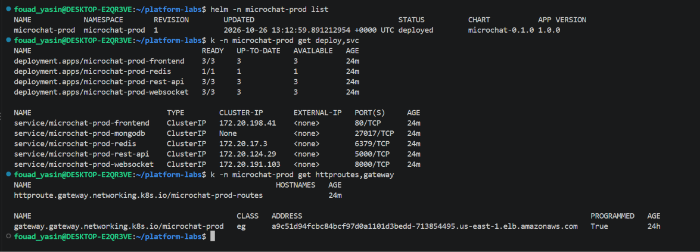
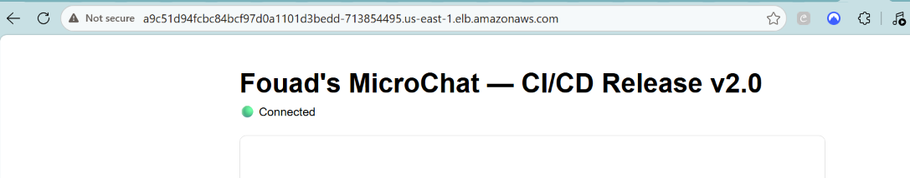
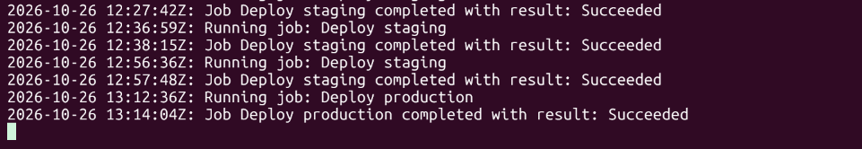

# MicroChat — Production CI/CD Security

This README documents the MicroChat CI/CD release in the same order as the evidence screenshots: first the workflow diagram, then the code change, staging pipeline and staging verification, PR validation, production promotion, and finally production verification.

## Pipeline Status

- **Staging Deployment:** [View Status](https://github.com/fouadyasin01/platform-labs/actions/runs/40326220145)
- **Production Deployment:** [View Status](https://github.com/fouadyasin01/platform-labs/actions/runs/40328385800)

**Pipeline Configuration:** [`.github/workflows/prod-cicd-sec.yml`](https://github.com/fouadyasin01/platform-labs/blob/master/.github/workflows/prod-cicd-sec.yml)

## 1. CI/CD workflow overview

The workflow diagram summarizes the intended delivery path:

1. Push changes to `feature/production-cicd-security`.
2. Run quality checks, tests, SAST, dependency auditing, image build and container scanning.
3. Publish SHA-tagged images, deploy to the staging namespace, and run smoke tests.
4. Open a pull request into `master`; PR checks validate the change but do not deploy to staging.
5. Merge the approved PR into `master`, promote the existing tested image, and deploy to production after the GitHub Environment approval gate.

GitHub Actions authenticates to AWS using IAM OIDC, avoiding long-lived AWS access keys. See the workflow file for the exact triggers and job dependencies.

## 2. Push pipeline: staging deployment

This GitHub Actions run is triggered by a push. The workflow graph shows quality checks, SAST, image build/scan/publish, and staging deployment completing successfully. The production deployment job is skipped for this push event.

## 3. Staging Kubernetes resources

The terminal evidence shows the Helm release `microchat-staging` in namespace `microchat-staging` with status `deployed`. The frontend, REST API, and WebSocket deployments each show `2/2` ready, while Redis shows `1/1`. The staging Gateway is shown as programmed and has an address.

## 4. Staging load balancer and browser verification

This browser screenshot shows the staging load-balancer hostname serving **“Fouad's MicroChat — CI/CD Release v2.0”** with a green **Connected** status. It provides browser-level evidence that the staging application is reachable through the staging Gateway/load balancer. The hostname shown is the value captured at the time of the screenshot and may change if the AWS load-balancer resources are recreated.

## 5. Pull request opened: build and security validation

The PR-triggered run completed successfully. The screenshot shows quality checks for the frontend, REST API, and WebSocket services, a successful SAST job, and image build/scan/publish jobs. Deployment jobs are not run in this PR validation path; staging deployment already occurred on the branch push.

## 6. PR merged: production image promotion and deployment

This run is associated with the pull request being closed/merged. The workflow graph shows the production image-promotion job and production deployment completing successfully. The intended release flow promotes the existing tested image rather than rebuilding a different image for production. Production deployment is protected by the configured GitHub Environment approval gate and runs on a self-hosted GitHub Actions runner (as reflected by the successful deployment job log evidence).

## 7. Production Kubernetes resources

The terminal evidence shows the Helm release `microchat-prod` in namespace `microchat-prod` with status `deployed`. The frontend, REST API, and WebSocket deployments each show `3/3` ready, Redis shows `1/1`, and the production Gateway is shown as programmed with an address.

## 8. Production load balancer and browser verification

This screenshot shows the **production load balancer DNS name** serving **“Fouad's MicroChat — CI/CD Release v2.0”** in the browser, with a green **Connected** status. It is browser-level evidence that the production application is rendered and reachable through the production load balancer. The DNS name is the value captured at screenshot time and may change if AWS load-balancer resources are recreated.

## 9. Successful deployment job logs

The log explicitly records staging deployment jobs and the production deployment job as **completed with result: Succeeded** on 26 October 2026. This screenshot is evidence that those deployment jobs succeeded.

## Security gates and  requirements

the pipeline to block on:

- Lint or formatting errors.
- Failed unit tests, with a minimum 70% coverage target.
- Critical or high SAST findings.
- Critical container vulnerabilities.

The pipeline also includes dependency auditing and container image scanning with Trivy. Verify the exact scanner severity thresholds, exit codes, and coverage enforcement in the workflow before submission; screenshots of successful runs do not independently prove how failing findings are handled.

## Evidence files

All screenshots used above are stored in [`docs/evidence/`](docs/evidence/). Keep the filenames and folder structure unchanged unless you also update the image references in this README.
